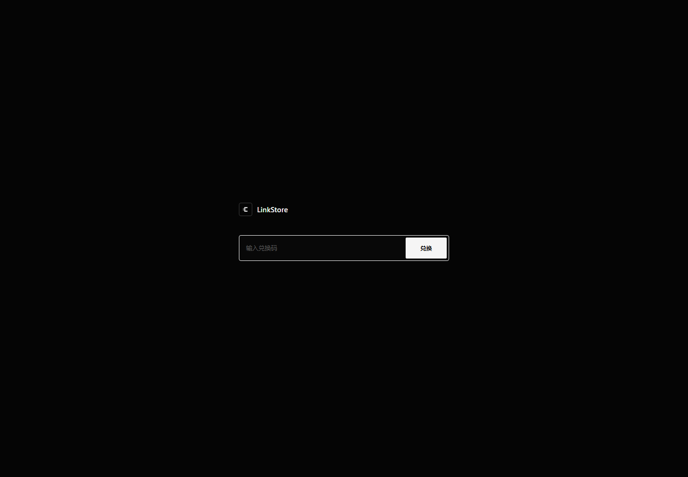
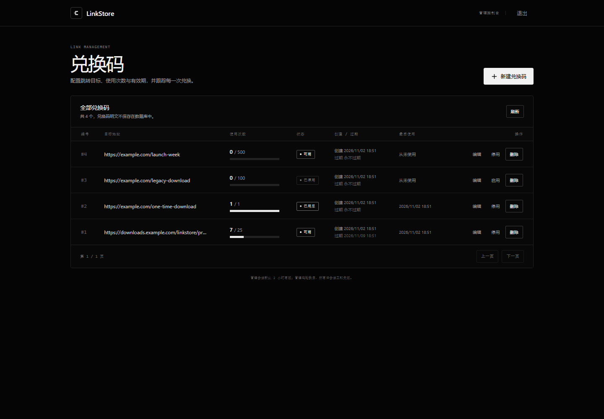
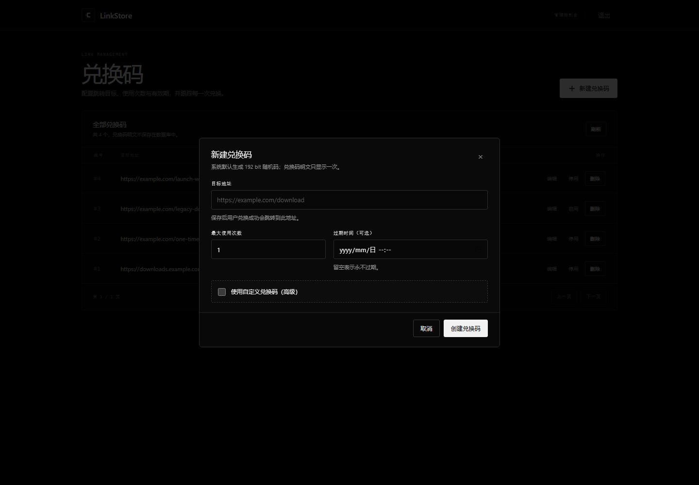

# LinkStore

一个部署在 Cloudflare 上的兑换码跳转商城。首页只有一个兑换码输入框：普通兑换码会原子扣减一次使用次数并跳转到后台配置的目标地址；输入管理码则建立短期管理会话并进入后台。

- 前端：Vue 3 + TypeScript + Vite
- 后端：Cloudflare Worker（TypeScript）
- 数据库：Cloudflare D1
- 静态资源：Workers Assets
- 会话：HMAC-SHA256 签名的 HttpOnly / Secure / SameSite=Strict Cookie
- 管理码：支持本地脚本自定义或随机生成，只保存 SHA-256 哈希
- 界面：纯黑白极简主题，无交互背景、无渐变、无发光

## 界面风格

- 全站只使用黑、白、灰三种色阶，强调色为白色。
- 首页只有品牌、兑换码输入框、提交按钮和错误提示，没有背景动画或装饰。
- 后台使用细边框、紧凑表格和等宽小标签，保持信息密度与可读性。
- 按钮、输入框、弹窗、状态标签全部采用直角或小圆角，不使用阴影、玻璃模糊和渐变动画。
- 移动端自动切换为单列布局。

### 界面预览

首页：



后台：



创建弹窗：



## 最短上线路径

如果这是第一次部署，按下面顺序执行。带 `[ ]` 的步骤全部完成后，网站才处于可用状态。

- [ ] **1. 安装依赖并登录 Cloudflare**
- [ ] **2. 创建 D1，替换 `wrangler.toml` 中的 `database_id`**
- [ ] **3. 对远端 D1 执行迁移**
- [ ] **4. 部署 Worker 与前端资源**
- [ ] **5. 写入生产 `SESSION_SECRET`**
- [ ] **6. 运行本地脚本，设置自定义管理码**
- [ ] **7. 打开站点，验证兑换和后台**

对应命令：

```bash
# 1
pnpm install
pnpm exec wrangler login

# 2
pnpm exec wrangler d1 create linkstore-db
# 将输出的 database_id 填入 wrangler.toml，替换全零占位值

# 3
pnpm db:migrate:remote

# 4
pnpm deploy

# 5：先生成密钥，复制输出
node -e "console.log(require('crypto').randomBytes(32).toString('base64url'))"
# 再写入远端 Secret，提示输入时粘贴上一步的值
pnpm exec wrangler secret put SESSION_SECRET

# 6
pnpm admin:set-code
# 选择 1) 远端 D1，然后输入两次自定义管理码
```

> `database_id` 仍是全零占位值时，`wrangler deploy` 会失败；这是首次部署最常见的错误。

## 项目结构

```text
.
├─ src/worker/
│  ├─ index.ts          Worker 入口；/api/* 走 API，其余交给 Assets
│  ├─ router.ts         路由和统一异常处理
│  ├─ redeem.ts         统一兑换入口、管理码识别、原子扣减、限流
│  ├─ admin.ts          管理会话校验、兑换码 CRUD、Origin 校验
│  ├─ session.ts        会话签名、Cookie、TTL、版本绑定
│  ├─ crypto.ts         SHA-256、时序安全比较、Base64URL
│  ├─ validation.ts     URL / 次数 / 过期时间 / 兑换码校验
│  ├─ audit.ts          审计写入与最近 1000 条保留策略
│  ├─ http.ts          JSON 响应、错误、请求体限制
│  └─ types.ts          Bindings 与数据库行类型
├─ frontend/
│  ├─ src/views/HomeView.vue
│  ├─ src/views/AdminView.vue
│  ├─ src/components/
│  │  ├─ ModalShell.vue        通用弹窗容器
│  │  ├─ CodeFormModal.vue     创建/编辑表单
│  │  ├─ GeneratedCodeDialog.vue 明文一次性展示
│  │  └─ ConfirmDialog.vue     删除确认
│  ├─ src/api.ts
│  ├─ src/types.ts
│  ├─ public/_headers   CSP 等静态资源安全响应头
│  └─ index.html
├─ migrations/0001_init.sql
├─ scripts/rotate-admin-code.mjs
├─ wrangler.toml
├─ vite.config.ts
└─ README.md
```

## 数据模型

### `admin_config`（单例，只允许 `id = 1`）

| 字段 | 说明 |
|---|---|
| `id` | 固定为 1，主键 |
| `admin_code_hash` | 管理码的 SHA-256 小写十六进制，仅存哈希 |
| `session_version` | 会话版本号，轮换管理码时递增 |
| `rotated_at` | 最近轮换时间（UTC ISO 8601） |

### `redemption_codes`

| 字段 | 说明 |
|---|---|
| `id` | 自增主键 |
| `code_hash` | SHA-256 哈希，唯一索引，不存明文 |
| `target_url` | 只允许绝对 http/https URL |
| `max_uses` | 最大使用次数，1–1,000,000 |
| `used_count` | 已使用次数 |
| `expires_at` | 可空；UTC ISO 8601 |
| `created_at` | 创建时间 |
| `last_used_at` | 可空；最后成功兑换时间 |
| `disabled` | 0/1，停用状态 |

### `audit_logs`

记录管理码兑换成功和后台写操作：`event_type`、IP、User-Agent、可选详情、时间。每次审计写入后裁剪到最近 1000 条。兑换码/管理码明文、哈希均不写入审计详情。

## HTTP API

| 方法 | 路径 | 鉴权 | 说明 |
|---|---|---|---|
| `POST` | `/api/redeem` | IP 限流 | 统一兑换入口 |
| `GET` | `/api/admin/session` | 管理会话 | 会话校验 |
| `POST` | `/api/admin/logout` | 管理会话 + Origin | 退出 |
| `GET` | `/api/admin/codes?page=1&pageSize=20` | 管理会话 | 分页列表 |
| `POST` | `/api/admin/codes` | 管理会话 + Origin | 创建兑换码 |
| `PATCH` | `/api/admin/codes/:id` | 管理会话 + Origin | 编辑 / 启停 |
| `DELETE` | `/api/admin/codes/:id` | 管理会话 + Origin | 删除 |

兑换成功响应会区分类型：

```json
{ "ok": true, "type": "redirect", "targetUrl": "https://example.com" }
{ "ok": true, "type": "admin", "redirectTo": "/admin" }
```

管理码错误、兑换码不存在、已用尽、已过期、已停用全部返回完全一致的：

```json
HTTP 400
{ "ok": false, "error": "INVALID_CODE" }
```

创建兑换码成功时，响应中的 `code` 明文只出现一次；数据库只保存哈希。

## 部署

### 0. 前置条件

- Node.js >= 22（建议使用 Node 22 或 24）
- pnpm
- Cloudflare 账号
- 一个 Cloudflare D1 数据库

### 1. 安装与登录

```bash
pnpm install
pnpm exec wrangler login
```

### 2. 创建 D1 并填写 database_id

```bash
pnpm exec wrangler d1 create linkstore-db
```

把输出中的 `database_id` 填到 `wrangler.toml` 的 `[[d1_databases]]`，替换全零占位值。`database_name` 默认是 `linkstore-db`。

如果使用不同数据库名，请同步修改：

- `wrangler.toml` 中的 `database_name`
- 执行脚本时的 `D1_DATABASE_NAME` 环境变量
- 下方迁移命令中的数据库名

### 3. 初始化远端 D1

```bash
pnpm db:migrate:remote
```

### 4. 部署 Worker 与静态资源

```bash
pnpm deploy
```

`pnpm deploy` 会先做类型检查、构建 Vue，再执行 `wrangler deploy`。Worker 与 Workers Assets 会一起发布。

### 5. 设置会话签名密钥

生成至少 32 字节的随机密钥，不要复用其他系统的密钥：

```bash
node -e "console.log(require('crypto').randomBytes(32).toString('base64url'))"
pnpm exec wrangler secret put SESSION_SECRET
```

粘贴第一步生成的值。生产环境的 `wrangler.toml` 中不要写这个密钥。

### 6. 设置自定义管理码

```bash
pnpm admin:set-code
```

脚本会先让你选择写入目标：

```text
1) 远端 D1（Cloudflare 上部署的网站）
2) 本地 D1（pnpm dev 本地开发）
```

部署阶段选择 `1`，然后输入两次自定义管理码。管理码长度要求 8–128 个字符，区分大小写，数据库只保存 SHA-256 哈希。

> 管理码不是默认值。未执行此步骤前，`admin_config` 中没有记录，任何输入都不会进入后台；普通兑换码仍可正常使用。

> 自定义管理码的安全性由长度和随机性决定。建议至少 20 个随机字符或 4 个随机词；如果追求最高安全性，使用 `pnpm admin:set-code -- --generate` 生成 256 bit 随机码。

### 7. 打开站点验证

- 首页只显示兑换码输入框。
- 输入管理码应进入 `/admin`。
- 后台创建兑换码后复制明文，再回首页兑换。
- 未登录直接访问 `/admin` 会被重定向回首页。

## 本地开发

macOS / Linux / Git Bash：

```bash
# 直接生成并写入，不会把密钥打印到终端
node -e "require('fs').appendFileSync('.dev.vars','SESSION_SECRET='+require('crypto').randomBytes(32).toString('base64url')+'\n')"
pnpm db:migrate:local
pnpm admin:set-code -- --local
pnpm dev
```

Windows PowerShell 同样使用上面的 Node 命令即可，不需要手动打开 `.dev.vars`。

如果 `.dev.vars` 中已经有 `SESSION_SECRET`，不要重复追加；先删除旧行再写入新值。

`pnpm dev` 先构建前端，再执行 `wrangler dev --local-protocol https`，因此 Secure Cookie 可以正常工作。浏览器会提示本地自签名证书，按本地开发流程信任即可。不要用 HTTP 打开本地站点验证后台，部分浏览器不会保存 `Secure` Cookie。

`pnpm admin:set-code` 不带目标参数时会提示选择本地或远端；加 `-- --local` 写入本地 D1，加 `-- --remote` 写入远端 D1。两条路径都会递增会话版本。脚本在写入本地 D1 前会检查 `.dev.vars` 是否存在有效的 `SESSION_SECRET`，避免设置完后无法登录。

## 自定义修改管理码

管理码支持完全自定义，不再强制使用随机串。管理码修改只通过本地脚本完成，不提供公网“改密接口”。

### 推荐用法

```bash
pnpm admin:set-code
```

脚本会依次完成：

1. 询问写入 **本地 D1** 还是 **远端 D1**；
2. 如果写本地 D1，先检查 `.dev.vars` 中是否存在有效的 `SESSION_SECRET`；
3. 如果写远端 D1，先检查 `database_id` 是否仍是占位值，并要求再次确认；
4. 让你输入自定义管理码，并再输入一次确认；
5. 计算 SHA-256，通过 Wrangler 更新对应 D1；
6. 同一条 UPSERT 中递增 `session_version` 并更新 `rotated_at`。

管理码要求 8–128 个字符，区分大小写，首尾空白会被去掉。旧管理码立即失效，所有旧后台会话也会立即失效。

### 跳过目标选择

```bash
# 本地开发 D1
pnpm admin:set-code -- --local

# 已在 Cloudflare 部署的远端 D1
pnpm admin:set-code -- --remote
```

`pnpm admin:rotate` 是同一个脚本的兼容别名。

写远端 D1 时，交互终端会要求输入 `yes` 再继续；非交互环境必须显式添加 `--yes`，避免误改生产数据：

```bash
pnpm admin:set-code -- --remote --yes
```

`--yes` 只建议用于确认过的自动化流程。

如果 Windows 终端里没有正常出现自定义管理码输入提示，可以用 PowerShell 的 `Read-Host` 读取后通过 stdin 交给脚本；这样管理码不会进入命令历史，也不需要交互式 TTY：

```powershell
$code = Read-Host "输入自定义管理码（8-128 字符）"
$confirm = Read-Host "再次输入确认"
if ($code -ne $confirm) { throw "两次输入不一致" }
"$code`n$confirm" | node scripts/rotate-admin-code.mjs --remote --yes
```

### 生成随机管理码

如果你不想自定义，或想要最高的随机熵：

```bash
pnpm admin:set-code -- --remote --generate
```

生成模式使用 `crypto.randomBytes(32)`，即 256 bit 熵，明文只在更新成功后显示一次。

### 自定义管理码的安全边界

- 自定义模式不能保证 128 bit 熵，安全性取决于你输入的码。
- 建议使用至少 20 个字符，或 4 个随机词，例如：`orbit-mango-river-82-cobalt`。
- 不建议使用姓名、生日、`admin123`、站点名等可猜测内容。
- 自定义码只从终端输入读取，不写入文件，也不会作为参数进入 shell 历史；但输入时会显示在当前终端。
- 如果更看重安全性，使用 `--generate`。

### 为什么后台没有“修改管理码”按钮

管理码是唯一管理凭证。开放公网改密接口会增加会话被盗后永久接管后台的风险，因此修改仍通过本地脚本 + Wrangler/D1 凭证完成。后台本身仍然没有修改管理码的功能。

### 忘记管理码

重新运行：

```bash
pnpm admin:set-code
```

选择对应 D1，设置新的自定义管理码即可。这是设计上的恢复手段。

### Wrangler 不可用时的控制台应急路径

Cloudflare Dashboard → D1 → 对应数据库 → Console。先在本地终端输入以下命令，再输入你想设置的自定义管理码：

```bash
node -e "const c=require('crypto'),r=require('readline').createInterface({input:process.stdin,output:process.stdout});r.question('新管理码: ',p=>{console.log('SHA-256:',c.createHash('sha256').update(p).digest('hex'));r.close()})"
```

然后在 D1 Console 执行（替换哈希与时间）：

```sql
UPDATE admin_config
SET admin_code_hash = '<SHA-256>',
    session_version = session_version + 1,
    rotated_at = '<UTC ISO 时间>'
WHERE id = 1;
```

如果 `admin_config` 为空，则执行：

```sql
INSERT INTO admin_config (id, admin_code_hash, session_version, rotated_at)
VALUES (1, '<SHA-256>', 1, '<UTC ISO 时间>');
```

不要把管理码明文粘贴到 Dashboard，只填 SHA-256 哈希。

### 使用最小权限 Token

不使用本机登录态时，可以创建仅用于 D1 的 API Token：

```powershell
$env:CLOUDFLARE_API_TOKEN = "<D1 最小权限 Token>"
$env:CLOUDFLARE_ACCOUNT_ID = "<Account ID>"
pnpm admin:set-code -- --remote
```

交互终端会要求确认远端写入；自动化脚本如需跳过，再添加 `--yes`。

或在 POSIX shell 中用 `export`。Token 应限定到账号/资源，只授予需要的 D1 编辑权限；不要使用 Global API Key，不把 Token 写进仓库。修改完成后可立即吊销。

可选环境变量：

- `D1_DATABASE_NAME`：覆盖默认的 `linkstore-db`
- `WRANGLER_ENV`：对应 Wrangler 的 `--env`

## 安全设计

- **仅存哈希**：管理码和兑换码都只保存 SHA-256 十六进制。后台无法恢复明文。
- **隐藏入口不是安全边界**：首页没有任何后台链接/按钮/提示，但 `/api/admin/*` 独立鉴权，后台页面加载时也会先调用会话校验。
- **管理码优先**：兑换接口先比较管理码哈希，命中则只签发会话，不消耗任何兑换次数；未命中才尝试扣减兑换码。
- **原子扣减**：使用单条带条件的 `UPDATE ... RETURNING`，条件同时包含哈希匹配、启用状态、未过期、`used_count < max_uses`。并发争抢最后一次时最多一个请求成功。
- **统一错误**：错误路径不区分管理码错误、兑换码不存在、已用尽、已过期；对外体和状态码一致。
- **会话**：载荷包含签发时间、过期时间、会话版本和随机 `jti`，用 HMAC-SHA256 签名。后台接口同时校验签名、未过期、D1 当前 `session_version` 与 Cookie 版本一致。
- **Cookie**：`HttpOnly; Secure; SameSite=Strict; Path=/`，默认 2 小时。轮换管理码递增版本，旧会话立即失效。
- **CSRF**：所有后台写操作校验 `Origin`；反向代理改写 Origin 时，使用浏览器 `Sec-Fetch-Site: same-origin` 或前端 `X-Requested-With` 自定义头兜底。API 不开放 CORS，跨域 JS 无法携带该自定义头。
- **限流**：`/api/redeem` 通过 Cloudflare Rate Limiting binding 按 `CF-Connecting-IP` 限制为 30 次/分钟。该限制在每个 Cloudflare 边缘节点近似计数，不是全球严格配额；核心安全仍依赖管理码强度、原子扣减和会话版本。binding 异常时有 per-isolate 内存兜底。
- **URL 白名单**：目标地址只接受绝对 `http:` / `https:` URL，拒绝 `javascript:`、`data:` 和带用户信息的 URL。
- **审计**：成功的管理码兑换、后台创建/编辑/删除/退出记录时间、IP、User-Agent；保留最近 1000 条。
- **无公网改密接口**：后台没有修改管理码的功能，只能通过本地脚本或 D1 控制台修改，避免会话被盗后永久接管后台。
- **不记录明文**：应用日志不记录兑换码、管理码、请求体或会话密钥。
- **前端不作为信任边界**：URL、次数、过期时间、会话状态全部以后端校验为准。

### 账号安全建议

- Cloudflare 账号开启 2FA，并保护邮箱和恢复方式。
- API Token 最小权限、限定资源、可随时吊销。
- 自定义管理码至少使用 20 个随机字符或 4 个随机词；随机模式生成 256 bit 管理码。
- 兑换码默认由系统生成 192 bit 随机码。自定义兑换码属于高级选项，`LinkStore` 会提示低熵风险。
- 会话密钥和管理码应分开保存；轮换会话密钥会立即让所有会话失效。
- 保留 Cloudflare Dashboard 手动修改 D1 的应急路径，但不要把明文写进任何持久文件。

## 配置项

`wrangler.toml`：

```toml
[vars]
SESSION_TTL_SECONDS = "7200"
```

- 默认 7200 秒（2 小时），代码中限制在 300–86400 秒。
- 修改后重新部署；已签发会话仍按自身 `exp` 到期（新 TTL 会限制超长令牌）。
- 限流参数在 `[[ratelimits]]` 的 `simple = { limit = 30, period = 60 }`；`namespace_id` 在同一 Cloudflare 账号内必须唯一，避免计数器与其他 Worker 共享。
- `wrangler` 与 `@cloudflare/workers-types` 使用精确版本，避免 pnpm 最小发布年龄策略拦截刚发布的包。升级前先确认版本已发布超过 24 小时。
- Workers Assets 的 `run_worker_first = ["/api/*"]` 确保 API 不会被静态资源吞掉，`/admin` 由 SPA fallback 提供。

## 常用命令

| 命令 | 作用 |
|---|---|
| `pnpm dev` | 构建前端并以本地 HTTPS 启动 Worker |
| `pnpm build` | 类型检查 + 构建前端 |
| `pnpm deploy` | 构建并部署 Worker/Assets |
| `pnpm db:migrate:local` | 应用本地 D1 迁移 |
| `pnpm db:migrate:remote` | 应用远端 D1 迁移 |
| `pnpm admin:set-code` | 交互选择 D1 并设置自定义管理码 |
| `pnpm admin:set-code -- --local` | 设置本地开发管理码 |
| `pnpm admin:set-code -- --remote` | 设置远端管理码 |
| `pnpm admin:set-code -- --remote --generate` | 设置 256 bit 随机管理码 |
| `pnpm admin:set-code -- --remote --yes` | 自动化场景跳过远端确认（谨慎） |
| `pnpm admin:rotate` | `admin:set-code` 的兼容别名 |
| `pnpm typecheck` | Vue 与 Worker TypeScript 检查 |
| `pnpm admin:set-code -- --help` | 查看脚本参数 |

## 常见问题排查

### `wrangler deploy` 报数据库不存在或 UUID 不合法

`wrangler.toml` 里的 `database_id` 还是全零占位值。执行 `pnpm exec wrangler d1 create linkstore-db`，把返回的 UUID 填回去。

### 页面能打开，但所有兑换都失败或后台报 500

按顺序检查：

1. 远端迁移是否执行：`pnpm db:migrate:remote`
2. 生产 Secret 是否存在：`pnpm exec wrangler secret list`
3. `SESSION_SECRET` 是否至少 32 字节
4. 是否已经执行 `pnpm admin:set-code -- --remote`

如果只是普通兑换码失败而管理码正常，检查 D1 的 `redemption_codes` 表是否存在。

### 管理码提示 `INVALID_CODE` 或用不了

按顺序排查：

1. **写错 D1 目标**：本地 `pnpm dev` 使用本地 D1，部署站点使用远端 D1。  
   - 本地：`pnpm admin:set-code -- --local`  
   - 线上：`pnpm admin:set-code -- --remote`
2. **使用的是修改前的旧管理码**：每次修改都会立即让旧管理码失效。
3. **管理码区分大小写**，检查是否复制了首尾空格或漏字符。
4. **是否为当前站点**：确认打开的 URL 对应本次写入的 D1，而不是另一个部署环境。
5. **`SESSION_SECRET` 缺失**：管理码匹配成功但签发会话失败时，接口会返回 500，而不是进入后台。
6. **本地 Cookie**：本地开发优先使用 `pnpm dev` 输出的 HTTPS 地址；部分浏览器不会在 HTTP 下保存 `Secure` Cookie。

### 输入管理码后仍回到首页

- 管理码是否正确，且是否是修改后的最新管理码。
- 本地开发必须使用 HTTPS（`pnpm dev`），否则某些浏览器不会保存 `Secure` Cookie。
- 浏览器是否禁用了 Cookie。
- 修改一次管理码后，旧会话会立即失效，这是预期行为。

### 后台原本正常，修改管理码后接口全部 401

这是设计行为。`session_version` 已递增，旧 Cookie 必须失效。重新在首页输入新管理码即可。

### 兑换返回 429

同一 IP 在当前 Cloudflare 边缘节点一分钟内超过了 30 次。等待一分钟，或调整 `wrangler.toml` 中的限流参数后重新部署。

### 所有无效输入都显示同一句错误

这是刻意设计。管理码错误、兑换码不存在、过期、用尽、停用不会向用户暴露具体原因，避免枚举。

### `pnpm` 提示 Node 版本过低

Wrangler 4 需要 Node.js 22 或更高版本。切换 Node 后重新运行 `pnpm install`。

### `ERR_PNPM_MINIMUM_RELEASE_AGE_VIOLATION`

pnpm 11 的最小发布年龄策略拒绝了几小时内刚发布的依赖。项目已将
`wrangler` 和 `@cloudflare/workers-types` 固定到通过冷却期的版本，正常情况下
重新执行即可：

```bash
pnpm install
pnpm exec wrangler login
```

如果升级依赖后再次出现，优先等待新版本超过策略窗口，或把这两个包回退到已发布
24 小时以上的版本；不建议直接关闭全局供应链策略。

### `pnpm exec wrangler` 报 `Unknown argument ...cli.js`

这是个别嵌入型 Node 环境对 Wrangler 启动器参数处理异常，不是 Cloudflare 账号问题。
可直接使用本地可执行文件：

```powershell
.\node_modules\.bin\wrangler.cmd login
.\node_modules\.bin\wrangler.cmd d1 create linkstore-db
```

macOS / Linux：

```bash
./node_modules/.bin/wrangler login
```

## 验收自检

1. 首页只有兑换输入框和提交按钮，没有任何后台入口。
2. 创建 `max_uses = 1` 的兑换码，连续兑换：第一次成功跳转，第二次返回统一错误。
3. 过期或停用的兑换码返回与不存在相同的 `INVALID_CODE`。
4. 输入错误管理码与无效兑换码，响应体、状态码一致。
5. 未登录访问 `/api/admin/codes` 返回 401；过期/轮换后的旧 Cookie 也返回 401。
6. 对同一个剩余 1 次的码并发请求，只有一个响应为成功；这是由条件 UPDATE 的数据库原子性保证的。
7. 执行 `pnpm admin:set-code` 并设置自定义管理码后，新管理码可以登录，旧管理码与旧后台会话立即失效。
8. 后台可以创建、编辑目标/次数/有效期、停用/启用、删除，并显示使用次数、最大次数、过期、创建、最后使用时间。

## 说明

- 兑换码明文无法恢复。如果管理员丢失明文，只能删除并重新创建。
- 所有时间以 UTC ISO 8601 存储，浏览器按本地时区展示。
- 目标地址由管理员配置，站点本身不抓取或代理目标页面；用户兑换后由浏览器直接跳转。
